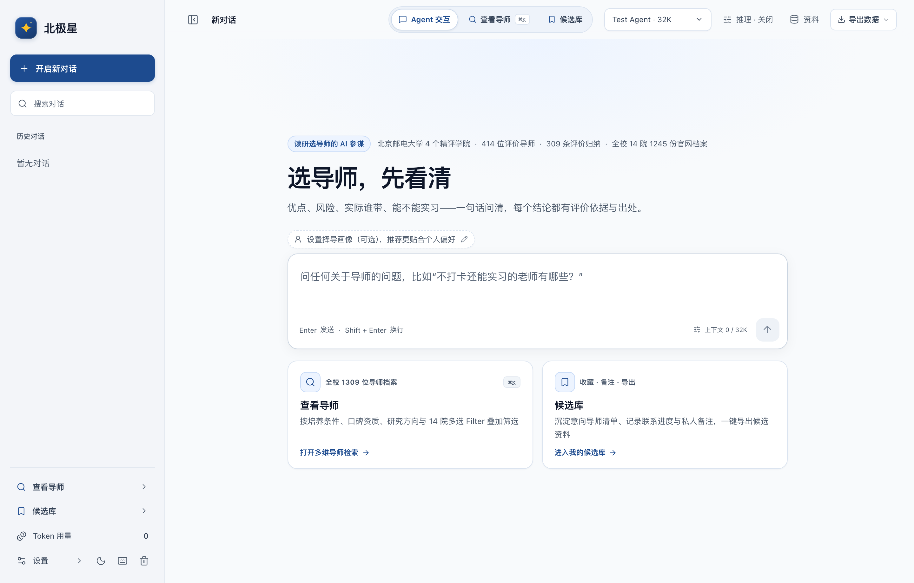
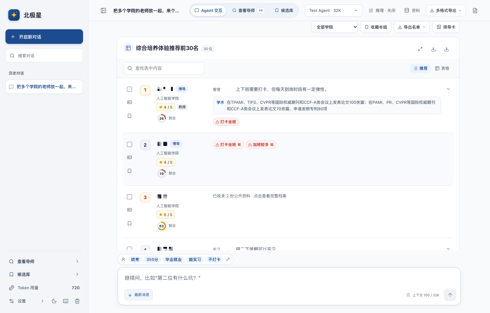
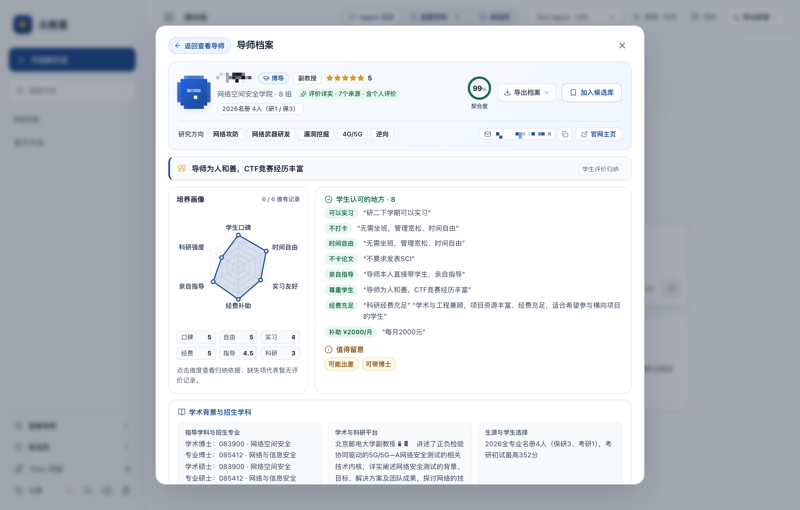
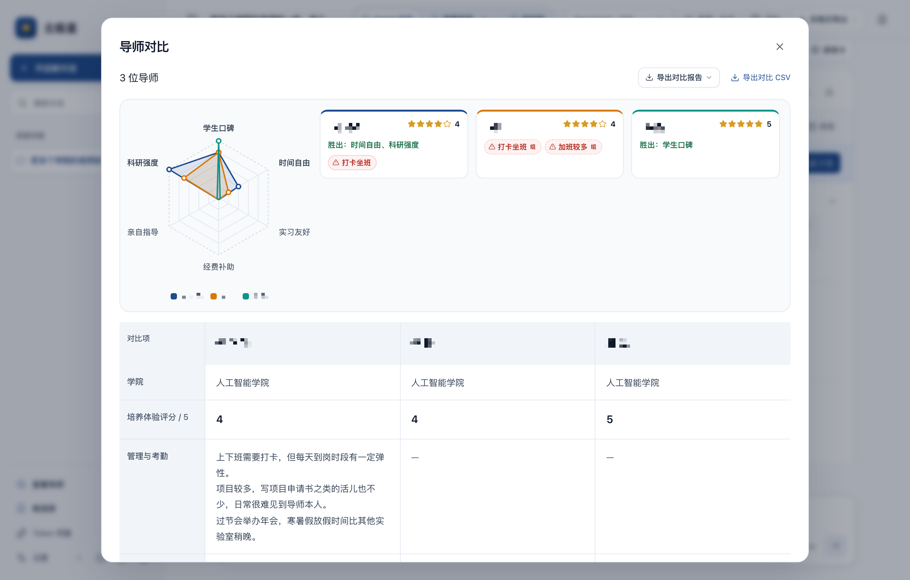
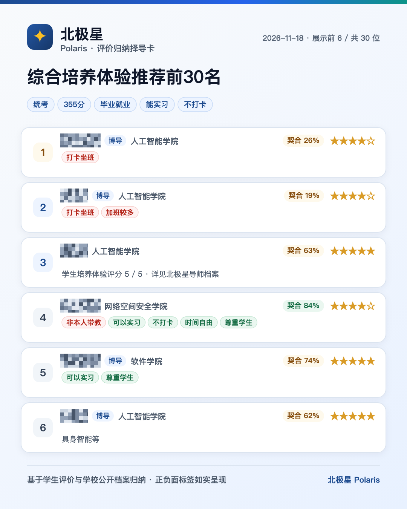
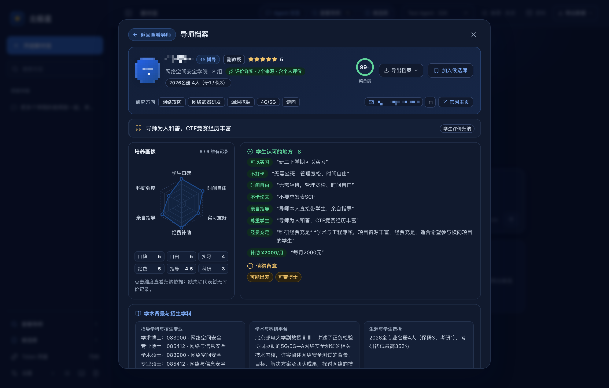
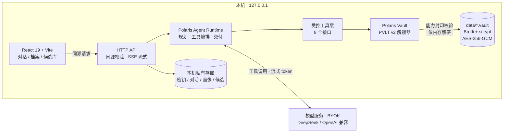
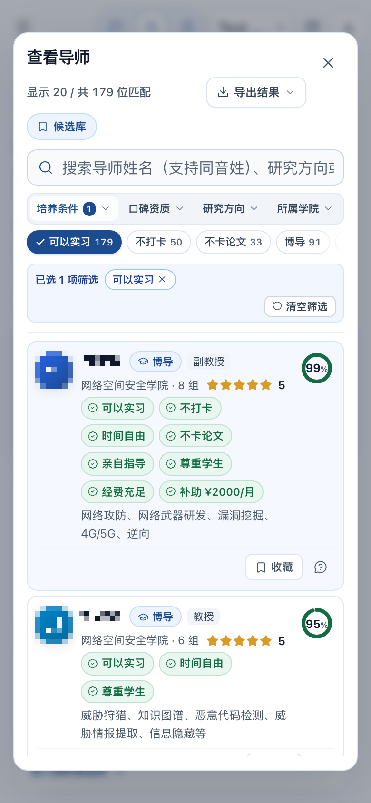

<div align="center">

# ✦ 北极星 Polaris

**读研选导师的 AI 参谋**<br/>
多维评价洞察 · 风险排雷 · 导师对决 · 智能套磁

<sub>选导师，先看清。</sub>

<br/>


[](https://nodejs.org/)
[](#security)
[](#quality)
[](LICENSE)

<br/>



<sub>一个对话框，装下评价洞察、导师档案、筛选漏斗与择导名单。</sub>

<br/>

[为什么是北极星](#why) · [核心能力](#capabilities) · [加密架构](#security) · [快速开始](#quickstart) · [系统架构](#architecture) · [CLI](#cli) · [质量保障](#quality)

</div>

---

<a id="why"></a>

## ✦ 为什么是北极星

选导师从来不只是“查一位老师的研究方向”。真正的难题藏在信息差里：评价散落在群聊与私下交流中，官网只写职称和论文，风险往往没人愿意明说，而手里的几个名字又很难放在一起比较。

北极星把这些碎片收进同一个对话界面。你用自然语言提问，Agent 调用真实数据完成检索、筛选、统计与对比，再把结论组织成档案、雷达图、名单、对决和可分享的分析卡。**每一条评价归纳都附评价依据，负面记录不被删除、不被淡化。**

> “不打卡、研二能出去实习、补助还不错的导师有哪些？”
>
> “哪些导师的评价提到挂名？实际带教的是谁？”
>
> “结合我的分数，按冲刺、稳妥、保底三档推荐导师，并点出各自风险。”
>
> “给名单里的第一位写一封套磁信，语气克制一点。”

| 择导时真正难的事 | 北极星的做法 |
| --- | --- |
| 评价零散，无法核对 | 将评价归纳为优点、风险与注意事项，逐条附上评价依据 |
| 官网信息太薄 | 六维培养画像、实际带教人、招生构成、公开邮箱与主页一屏呈现 |
| 风险没人敢说 | 压榨、骂人、挂名、限制实习、打卡等风险标签与优点同等醒目 |
| 人选比不动 | 多导师雷达叠加对决，维度胜出者与风险并列展示 |
| 结论留不住 | 候选库、私人备注、联系进度、方案版本与一键导出报告 |

---

<a id="capabilities"></a>

## ✦ 三大核心能力

| 能力 | 入口 | 一句话 |
| :--- | :--- | :--- |
| **Agent 交互** | 对话框 | 把口碑、排雷、方向匹配、冲稳保与套磁问题一次问透 |
| **查看导师** | <kbd>⌘K</kbd> / <kbd>Ctrl K</kbd> | 在全校导师库中实时检索，用多维条件收窄到具体人选 |
| **候选库** | 顶部「候选库」 | 沉淀意向清单、备注与进度，完成对决、报告与分享卡 |

### 01 · Agent 交互 —— 把择导问题问到底

- **自然语言追问**：口碑如何、有没有坑、方向是否匹配、冲稳保怎么排、套磁信怎么写，都可以直接问，不需要学习查询语法。
- **流式推理与过程可见**：回答边生成边呈现，检索与统计过程以活动状态展示，不必对着加载动画干等。
- **30 秒择导画像**：报考方式、读研目标、最看重的条件与分数常驻对话上下文；之后每一轮推荐都按你的情况计算契合度，也可以说“记住我更看重实习”随时更新。
- **多维筛选漏斗**：用真实查询数量展示候选从全校逐步收窄到最终名单的过程，每一层收窄都可解释。
- **个性化套磁信**：结合导师方向、公开邮箱与你的经历生成初稿；未提供的个人信息留空，不替你编造身份。
- **答案即入口**：正文中的导师名、逐人小标题可以直接打开档案；每轮回答后给出“对比前两位”“这些人有什么坑”“写套磁信”等下一步动作。



<sub>画像契合度、红绿标签、六维画像与筛选漏斗，在同一条回答里完成。</sub>

### 02 · 查看导师 —— <kbd>⌘K</kbd> 打开全校档案

- **全校实时检索**：覆盖 **14 个学院、1,300+ 位导师**，支持按姓名、方向、学院与标签快速定位。
- **32 项筛选自由叠加**：培养条件（可以实习、不打卡、时间自由、不卡论文、亲自指导、补助优厚……）、口碑资质（博导、教授、零负面评价、非挂名带教、评分区间……）与研究方向（大模型、6G、网络安全、密码学、计算机视觉……）三组 Filter 可任意组合，并叠加所属学院多选。
- **Bento 双栏等高档案**：左侧培养事实与六维画像，右侧风险、优点与评价依据；长内容自动对齐，不出现参差留白。
- **六维培养画像雷达**：学生口碑、时间自由、实习友好、经费补助、亲自指导、科研强度，每一维都能展开查看依据与证据强度。
- **信息完整可核对**：实际带教人、招生构成、历年分数、公开邮箱、官网主页与来源链接一并保留；没有记录的维度显示为空，不按低分处理。



<sub>Bento 双栏等高布局：培养画像、风险标签、评价依据与公开资料一次看清。</sub>

### 03 · 候选库 —— 从心动的名字到可执行清单

- **意向沉淀**：收藏导师、写私人备注、维护联系进度，按清单分类管理，不再散落在备忘录和截图里。
- **多导师雷达叠加对决**：把 2–4 位候选人放进同一张雷达图，标出每个维度的胜出者，风险并排列出，下方保留逐项培养条件对照表。
- **方案与版本**：保存不同择导方案，比较差异，回看每一次取舍的依据。
- **全格式一键导出**：支持将对话建议、推荐名单、5 星高口碑/零风险/可实习不打卡等筛选结果、导师对比、单人完整档案与候选库导出为 **Excel (`.xlsx`)**、**PDF (`.pdf`)**、**Word (`.docx`)**、**Markdown (`.md`)** 与 CSV，亦可生成 **1080 × 1350** 择导分析卡 PNG。
- **深色模式与无障碍**：支持「跟随系统 / 浅色 / 深色」三档主题（在「设置 → 外观」或侧栏底部一键切换），首屏零闪烁生效，浅色与深色双主题均通过 **WCAG 2AA** 对比度与无障碍扫描。
- **快捷键与即时反馈**：按 <kbd>?</kbd> 或 <kbd>⌘/</kbd>（<kbd>Ctrl /</kbd>）打开快捷键速查面板；收藏、复制与导出等操作均提供全局实时提示。
- **全部功能开放**：没有会员分级，也没有被锁住的导出按钮。

<table>
<tr>
<td width="50%" align="center" valign="top">
<br/>
<sub><b>导师对决</b> · 雷达叠加、维度胜出者与风险并列</sub>
</td>
<td width="50%" align="center" valign="top">
<br/>
<sub><b>择导分析卡</b> · 一键生成的 1080 × 1350 分享图</sub>
</td>
</tr>
</table>



<sub><b>深色模式</b> · 跟随系统 / 浅色 / 深色一键切换，双主题均通过 WCAG 2AA 对比度与无障碍校验。</sub>

---

<a id="security"></a>

## ✦ 数据安全与防搬迁加密架构

> [!IMPORTANT]
> 导师评价归纳与档案不是普通静态资源。公开分发形态只提供加密后的 `.vault` 二进制数据包，**仓库与发布包中不存放任何明文 JSON 数据**；数据只能由北极星 Agent API 运行时在本机内存中按需解锁。

### 同义脱敏，先处理再封存

所有评价在进入数据管线前都会经过**同义脱敏转译**：去除可识别个人身份的信息，保留培养方式、管理风格、实习安排、补助与带教关系等核心事实；评分、劳务金额、招生人数与成绩统计不做篡改，并由单元测试校验数量与口径一致。每个标签只做评价归纳，并绑定对应的评价依据；团队来源的标签带“组”字角标，个人记录优先于团队共性。

### Polaris Vault（`PVLT` v2 · 项目内置解密与防搬迁封印）

内置的数据加密封存引擎将数据集压缩、派生密钥并整体加密，输出带魔数与完整头部的二进制密文包：

```text
┌──────────┬────────────┬──────────┬──────────┬─────────────────────────────┐
│  PVLT\x02 │  salt 16B  │  iv 12B  │ tag 16B  │  AES-256-GCM ciphertext …   │
└──────────┴────────────┴──────────┴──────────┴─────────────────────────────┘
     魔数        随机盐       随机 IV    认证标签      Brotli 压缩后的密文载荷
```

| 层次 | 实现 |
| :--- | :--- |
| 封装格式 | `PVLT` v2，固定魔数 + 长度校验 + 按数据包绑定 AAD |
| 压缩 | Brotli，质量等级 11，先压缩后加密 |
| 密钥派生 | `scrypt`（N = 16384，r = 8，p = 1），每个数据包独立 16 字节随机盐；默认使用项目内置绑定派生密钥，也支持通过 `MENTOR_VAULT_KEY` 覆盖为私有密钥 |
| 对称加密 | AES-256-GCM，12 字节随机 IV、16 字节认证标签；仓库仅存密文，脱离本项目运行时边界不可直接解密 |
| 运行时绑定 | 解密入口校验 `lib/data.js` 授权调用边界与私有运行时能力令牌；默认开箱自动解密，如设置 `POLARIS_FORCE_LOCK=1` 或不匹配的自定义 `MENTOR_VAULT_KEY` 则进入锁定态并可通过 `POST /api/vault/unlock` 解锁 |
| 内存策略 | 解锁结果仅驻留进程内存并按查询返回副本，不落盘、不写入浏览器存储 |

### 只有 8 个受控工具能触达数据

数据访问不暴露文件系统接口，也不提供“整库下载”端点。Agent 只能通过 **8 个受控工具接口** 发起查询：

`catalog` · `search` · `query` · `join` · `aggregate` · `visualize` · `workspace` · `profile`

HTTP 层同时实施多重约束，阻断批量抓取与异地搬迁：

- **仅本机监听**：服务默认绑定 `127.0.0.1:3210`，拒绝非本机 Host。
- **同源校验**：带 `Origin` 的浏览器请求必须与当前 Host 一致，跨站页面无法直接调用本地 API。
- **反爬单次上限**：HTTP Agent API（`POST /api/tools/*`）单次查询严格限制最多 100 行，超出立即返回 `403 BULK_EXPORT_BLOCKED`；评价来源预览最多返回 20 条摘要。
- **关联主键剥离**：HTTP 工具输出与展示投影自动剥离 `mentor_id`、`review_id`、`student_id`、`exam_id`、`source_locator` 等底层关联主键，杜绝异地重建关系表。
- **项目独占能力封印**：`.vault` 解密校验项目内部运行时能力令牌与授权调用链；未提供自定义密钥时直接通过内置机制安全解锁，显式触发锁定态（`POLARIS_FORCE_LOCK=1` 或密钥不匹配）时自动降级启动。

Vault 的目标是阻止未加密原始数据进入公开仓库并提高直接复制与批量搬运的门槛。仓库默认数据包可开箱运行；如需私有重封装，请使用 `npm run data:seal -- --custom` 并设置独立的 `MENTOR_VAULT_KEY`。

<details>
<summary><b>维护者：重新加封与防泄漏校验</b></summary>

<br/>

```bash
# 将明文数据源加密为 data/*.vault，并把明文移入 .local/plaintext-data/（已被 git 忽略）
npm run data:seal

# 如需为私有部署使用自定义 MENTOR_VAULT_KEY，请追加 --custom：
# npm run data:seal -- --custom

# 执行防明文泄漏与 Vault 完整性审计
npm run vault:check

# 构建发布包；打包脚本会拒绝 .env、原始名册、PDF、__pycache__、压缩包等敏感文件
npm run package
```

发布前请运行 `npm run vault:check` 确认 `data/` 中只剩 `.vault` 文件、Git 索引零明文泄漏。明文备份目录不得进入版本控制，也不得随发行包分发。

</details>

---

<a id="quickstart"></a>

## ✦ 快速开始

### 方式一：独立桌面客户端（推荐 · 零门槛，无需安装 Node.js 或打开浏览器）

北极星提供原生桌面应用，双击即可在独立窗口中使用全部功能，内置加密库解包引擎，不需要配置终端或手动编辑环境变量：

- **macOS 安装与使用**：
  1. 前往 GitHub Releases 下载对应架构的 `Polaris-*-mac-arm64.dmg`（Apple Silicon 芯片，M1–M4）或 `Polaris-*-mac-x64.dmg`（Intel 芯片）。
  2. 双击打开 `.dmg`，将 **Polaris** 拖入 **「应用程序 / Applications」** 文件夹。
  3. 首次打开若 macOS 提示“无法验证开发者”（开源社区未签名构建），请在「应用程序」中**右键点击 Polaris → 选择「打开」**即可，或在终端执行一次 `xattr -cr /Applications/Polaris.app`。
- **Windows 安装与使用**：
  1. 下载 `Polaris-*-win-x64-setup.exe`（标准安装向导，带桌面/开始菜单快捷方式）或 `Polaris-*-win-x64-portable.exe`（免安装绿色便携版，双击即用）。
  2. 若 Windows SmartScreen 提示未知发布者，点击「更多信息 → 仍要运行」即可。
- **软件内可视化配置 API Key 与 URL（只需 10 秒）**：
  1. 打开软件后点击右上角 **「连接模型」**（或菜单栏 `Polaris → 模型与接口设置…` / 快捷键 `Cmd+,` / `Ctrl+,`）。
  2. 点击顶部预设一键填入服务商地址（支持 **DeepSeek、OpenAI、OpenRouter、硅基流动、本地 Ollama** 或自定义兼容接口），填入 **API Key**，点击 **「测试连接」** 确认连通后点击 **「连接并保存」** 即可立即开始对话。
  3. 你的密钥与偏好仅保存在本机系统应用数据目录（macOS `~/Library/Application Support/MentorLens/`，Windows `%APPDATA%\MentorLens\`），绝不会写入仓库或上传外部。

---

### 方式二：源码 / 浏览器 / CLI 运行（适合开发者与终端用户）

**环境要求**：Node.js **22.12+**，npm 10+。支持 **Windows / macOS / Linux**：

- **源码本地桌面 App 模式**：`npm run desktop:start`（直接以独立桌面窗口启动）
- **浏览器一键启动**：
  - **Windows**：双击根目录 `start.cmd`（命令行运行时可附带 `--open` 自动打开浏览器）
  - **macOS**：双击根目录 `start.command`（自动查找 Homebrew / nvm / fnm / volta / asdf / mise 中的 Node 22.12+；命令行运行时可附带 `--open` 自动打开浏览器）
  - **全平台命令行**：`npm run launch`（如需要启动后自动打开浏览器，可运行 `npm run launch -- --open`）
- **手动命令启动**（macOS / Windows / Linux 通用）：

```bash
# 1. 安装依赖
npm install

# 2. 构建前端
npm run build

# 3. 启动本机服务
npm start
```

终端出现 `北极星 已启动：http://127.0.0.1:3210` 后，在浏览器打开：

**<http://127.0.0.1:3210>**

首次使用点击右上角 **「连接模型」**，在 **「连接设置 → 模型连接」** 中填写你自己的 API Key：

| 配置项 | 说明 | 示例 |
| :--- | :--- | :--- |
| API 地址 | OpenAI 兼容接口的基础地址 | `https://api.deepseek.com` |
| API Key | **你自己的**模型密钥（BYOK） | `your_api_key_here` |
| 模型 | 需支持工具调用（Function Calling） | `deepseek-chat` |

也可以复制 `.env.example` 为 `.env`，使用环境变量启动：

```dotenv
MENTOR_API_URL=https://api.deepseek.com
MENTOR_MODEL=deepseek-chat
MENTOR_API_KEY=your_api_key_here
PORT=3210

# 可选：仅当使用 `npm run data:seal -- --custom` 自定义密钥重封装时需要覆盖；默认内置解密开箱可用
# MENTOR_VAULT_KEY=change_me_in_production
```

> [!WARNING]
> 本项目**不包含、也不需要任何真实 API Key**。请勿把 `.env`、密钥或私有数据提交到版本控制；`.env` 已在 `.gitignore` 中排除。密钥仅保存在本机私有数据目录，浏览器无法读取已保存的 Key。

开发模式（Vite 热更新 + 本机 API）：

```bash
npm run dev
```

---

<a id="architecture"></a>

## ✦ 系统架构



一次提问的完整链路：

1. 浏览器通过同源请求把问题交给本机 HTTP 服务，回答以 SSE 流式返回。
2. Agent Runtime 规划任务，调用 `search`、`query`、`aggregate`、`visualize` 等受控工具。
3. 工具经能力封印向 Vault 申请解锁，密文在内存中完成 GCM 校验、解压与解析。
4. 模型把真实查询结果组织成结论、图表与名单；展示层剥离内部 ID 与工具参数后再交付。

---

<a id="cli"></a>

## ✦ Agent CLI 工具速览

CLI、HTTP API 与内置 Agent 共用同一个工具内核。外部 Agent 不需要启动前端，也不需要模型密钥，即可直接通过项目内置解密机制查询加密数据：

**macOS / Linux (`bash` / `zsh`) 与 PowerShell 7.3+：**

```bash
node bin/mentor.mjs schemas
node bin/mentor.mjs catalog
node bin/mentor.mjs query --from mentors --where '[{"field":"red_flags","op":"contains","value":"压榨"}]' --select name,college,red_flags,actual_supervisor
```

**Windows `cmd.exe` / PowerShell 5.1（或任何终端避免引号转义问题）：**

Windows `cmd.exe` 不把单引号 `'...'` 当作定界符，系统自带 PowerShell 5.1 向原生命令传递 `'...'` 时也会剥离内部双引号；推荐将筛选条件保存为 UTF-8 JSON 文件后使用 `--where-file` / `--json-file`，或通过标准输入 `--json -` 传入（自动忽略 UTF-8 BOM）：

```bat
node bin/mentor.mjs query --from mentors --where-file filters.json --select name,college,red_flags,actual_supervisor
```

也可以在 `cmd.exe` 中直接转义双引号：

```bat
node bin/mentor.mjs query --from mentors --where "[{\"field\":\"red_flags\",\"op\":\"contains\",\"value\":\"压榨\"}]" --select name,college,red_flags,actual_supervisor
```

| 工具 | 能力 |
| :--- | :--- |
| `catalog` | 发现数据集范围、字段类型、来源、年份与统计口径 |
| `search` | 跨来源召回研究主题、培养路线、评价导师与全校官网主页 |
| `query` | 筛选、派生列、多字段排序、分页与按真实顺序编号 |
| `join` | 按等值键关联导师、评价、匿名名册与成绩样本 |
| `aggregate` | 计数、均值、中位数、分位数、标准差、相关系数与直方图分桶 |
| `visualize` | 将真实结果交付为图表、推荐名单或对比表 |
| `workspace` | 候选库、清单、方案、对比与报告（需本机服务） |
| `profile` | 读取或更新择导画像（需本机服务） |

`mentors` 数据集额外提供 `green_flags`、`red_flags`、`watch_flags` 与 `actual_supervisor`，可直接筛选风险记录或挂名带教情况。完整字段与管道语义见 [工具协议](docs/TOOLS.md)，给外部 Agent 的接入说明见 [Agent 指南](docs/AGENT.md)。

---

## ✦ 数据范围与筛选口径

| 数据 | 规模与口径 |
| :--- | :--- |
| 可检索导师 | **1,309 位**：414 位评价导师与全校公开导师合并去重，覆盖 **14 个学院** |
| 公开档案 | **1,245 页**官网与第三方介绍，含职称、方向、邮箱与指导学科 |
| 评价归纳 | **309 条**个人或组内评价，归纳为 26 类优点、风险与注意事项 |
| 择导速查 | **32 项**筛选条件，分属培养条件、口碑资质与研究方向三组 |
| 匿名名册 | 376 条，118 人考研、258 人保研；不包含姓名、学号与联系方式 |
| 初复试样本 | 158 位进入复试者、137 位拟录取（网络空间安全学院） |

数据口径、来源、更新方式与使用边界见 [DATA.md](DATA.md)。所有名单、人数、分值与标签均来自真实记录；某个维度缺少记录时保持为空，不推断为低分。

---

<a id="quality"></a>

## ✦ 质量保障

| 层级 | 命令 | 覆盖范围 |
| :--- | :--- | :--- |
| 单元与接口 | `npm test` | 完整 `node:test` 套件：数据口径、工具协议、洞察标签、画像与契合度、HTTP、流式交付、导出、多学院档案与 Vault 安全 |
| 浏览器 E2E | `npm run test:e2e` | Playwright 验证桌面与手机流程、流式稳定性、导师对决、导出与候选库 |
| 无障碍 | 随 E2E 执行 | `@axe-core/playwright` 按 **WCAG 2A / 2AA** 扫描浅色与深色双主题核心页面与交互流程 |
| 真实模型冒烟 | `npm run test:live` | 使用你配置的模型密钥验证端到端问答（可选） |
| 数据防泄漏审计 | `npm run vault:check` | 审计 Git 索引、`.vault` 头部与构建/解锁边界，确保零明文外泄 |

CI 在 **Linux / macOS / Windows** 三个平台、**Node 22 / 24** 两个版本上运行 Vault 审计、单元测试、生产构建、跨平台 CLI/启动器检查与发布包解压冒烟测试，并单独执行 Chromium 浏览器测试。

<table>
<tr>
<td width="46%" align="center" valign="top">
<br/>
<sub>移动端同一套能力：检索、档案与对话完整可用</sub>
</td>
<td width="54%" valign="top">

**可核对，才敢用于决策。**

- 每个结论都能回到对应的评价依据、公开网页或统计样本。
- 图表与名单由工具查询结果直接生成，不由模型手写数值。
- 内部 ID、文件路径与工具 JSON 不会出现在页面、复制内容或导出文件中。
- 风险标签与优点标签使用同一套证据链，负面评价不被隐藏。

</td>
</tr>
</table>

---

## ✦ 目录结构

```text
Polaris/
├── electron/     Electron 跨平台独立桌面端主进程与预加载桥接
├── build/        Windows (.ico) / macOS (.icns) / PNG 应用图标资源
├── bin/          CLI 入口（polaris / 兼容别名 mentor-buffet）
├── lib/          数据加载、工具内核、多格式导出引擎、评价洞察、画像、筛选与 Vault
├── server/       本机 HTTP、模型适配、Agent 循环、工作台、导出服务与交付投影
├── src/          React 界面：对话、导师档案、对决、漏斗、择导卡、可视化设置
├── data/         加密 .vault 数据包（零明文数据）
├── scripts/      启动引导、图标生成、数据构建、导入、加封、防泄漏审计与发布打包
├── tests/        单元、接口、跨平台与 Playwright 浏览器测试
├── docs/         版本说明、工具协议、图片与发布文档
├── start.cmd     Windows 一键启动器（CRLF）
├── start.command macOS 一键启动器（LF）
└── .gitattributes 跨平台换行符与二进制文件规则
```

---

## ✦ 版权、数据权利与免责声明

- **代码许可**：源代码采用 [MIT License](LICENSE)。MIT 仅覆盖代码，不覆盖导师评价、评价归纳、加密数据包及第三方公开资料。
- **数据权利**：评价数据及其归纳结果受著作权与数据库权利保护，并以 Polaris Vault 加密存储。仅限个人择导参考，不得用于训练、转售、批量分发或任何商业用途。
- **禁止搬迁**：严禁逆向工程、破解或绕过 Vault、批量抓取、异地部署评价库、商业转载与任何形式的“数据搬运”。违反者需自行承担法律责任。
- **AI 误差**：评价归纳与画像由程序与模型协同生成，可能存在遗漏或偏差；导师安排、招生名额与培养要求请以学校、学院和导师的官方信息为准。
- **录取与联系**：本项目不构成任何录取承诺，也不代表任何高校或学院。套磁信仅提供草稿，发送前请自行核对事实与措辞。
- **隐私**：公开数据不包含学生姓名、学号或联系方式；服务只监听本机，密钥、对话与候选仅保存在本机私有目录。
- **第三方资料**：官网与第三方页面版权归原作者及发布机构所有；如权利人认为内容使用不当，可通过 Issue 联系处理。

---

<div align="center">

<sub>✦</sub>

**选导师，先看清。**

<sub>如果这盏北极星对你有帮助，欢迎 Star、提交 Issue，或把择导卡分享给同样在选导师的人。</sub>

<br/>

<sub>Built with care · Polaris 5.0.0 · MIT</sub>

</div>
